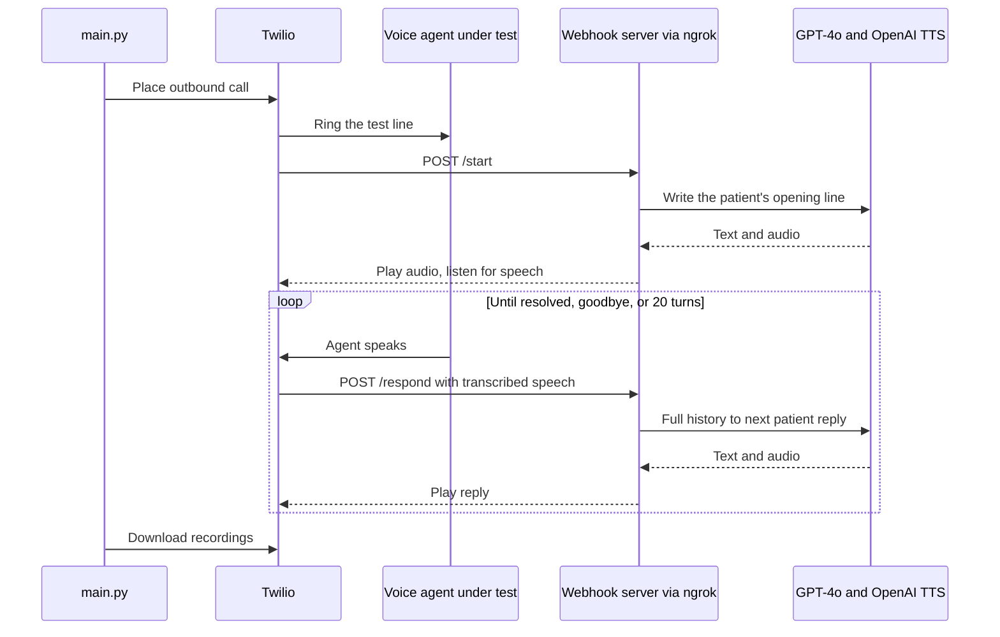

# AI Voice Bot for Testing Healthcare Voice Agents

An automated caller that stress tests a healthcare AI voice agent over real phone calls. It plays 10 different fictional patients, each with their own goal, voice and personality, and keeps talking until the request is truly resolved. Every call is recorded and transcribed, and the results became a report of 10 bugs in the agent under test.

Built for the Pretty Good AI engineering challenge, against their Athena test line.

## Results

| Metric | Value |
|---|---|
| Real phone calls made | 11 |
| Patient scenarios | 10 |
| Bugs found | **10**, including 3 critical |
| Total cost | About $5 |

The full write up is in [bug_report.md](bug_report.md). Transcripts are in `transcripts/` and call recordings in `recordings/`.

## How it works



1. A small HTTP server starts on port 8080, and ngrok gives it a public URL for Twilio.
2. For each scenario, Twilio calls the agent's number and hits `/start` when it connects.
3. GPT-4o writes the patient's first line from a detailed persona, and OpenAI TTS turns it into speech in that patient's voice.
4. Twilio transcribes each agent reply and posts it to `/respond`. GPT-4o reads the whole conversation so far and writes the next patient line.
5. The patient is told not to hang up until the goal is fully met, such as a confirmed date and time. The loop stops when the conversation ends or after 20 turns.
6. Each transcript is saved, and the full two sided recordings are downloaded from Twilio at the end.

## Scenarios

| # | Patient | Scenario |
|---|---|---|
| 1 | John Smith | Schedule a routine appointment |
| 2 | Maria Garcia | Medication refill |
| 3 | David Lee | Reschedule an appointment |
| 4 | Susan White | Insurance question |
| 5 | Robert Johnson | Confused elderly patient |
| 6 | Emily Chen | Urgent same day appointment |
| 7 | Michael Brown | Weekend appointment |
| 8 | Jennifer Davis | Cancellation |
| 9 | James Wilson | Several requests in one call |
| 10 | Patricia Martinez | Unclear, rambling patient |

Each patient uses a different OpenAI TTS voice matched to the persona, which also tests the agent's speech recognition across voices.

## Bugs found

| # | Bug | Severity | Calls affected |
|---|---|---|---|
| 1 | Assumes the caller's identity from the phone number | Critical | All 11 |
| 2 | Patient verification fails even with correct details | Critical | All 11 |
| 3 | Transfer to a representative hangs up on the caller | Critical | All 11 |
| 4 | Garbled and incomplete replies | High | 8 of 11 |
| 5 | Asks for date of birth several times in one call | High | 6 of 11 |
| 6 | Cannot cancel and rebook in the same call | High | 1 of 11 |
| 7 | Contradictory appointment confirmations | High | 1 of 11 |
| 8 | Drops calls early | Medium | 1 of 11 |
| 9 | Cannot answer basic clinic questions | Medium | 1 of 11 |
| 10 | Speech recognition errors lead to wrong actions | Medium | 2 of 11 |

Each bug has the calls it appeared in, why it matters for patients, and the expected behavior.

## Design decisions

* **Twilio and ngrok instead of a hosted server.** Twilio handles dialing, recording and speech recognition, and ngrok exposes a local server. Nothing needed to be deployed, and the whole run cost about $5.
* **A goal driven patient, not a script.** Because the patient only stops when its request is resolved, the bot finds failures a fixed script would miss.
* **Five small modules.** Personas, the patient brain, webhooks, call management and transcripts are separate, so a new scenario or a different TTS provider is a small change.

More detail is in [architecture.md](architecture.md). [ai_debugging_session.md](ai_debugging_session.md) shows how I debugged the bot itself, such as Twilio calling before the server was ready.

## Project structure

```
main.py            Starts the server and runs all scenarios
server.py          Twilio webhooks for /start and /respond
patient.py         GPT-4o patient replies and OpenAI TTS
call_manager.py    Outbound calls and recording downloads
scenarios.py       The 10 patient personas
transcript.py      Saves each conversation
transcripts/       One transcript per call
recordings/        Full call recordings
bug_report.md      The 10 bugs found
```

## Running it

You need a paid Twilio account, an OpenAI key and ngrok.

```bash
pip install -r requirements.txt
cp .env.example .env
```

Fill in `.env`:

| Variable | Description |
|---|---|
| TWILIO_ACCOUNT_SID | Twilio account SID |
| TWILIO_AUTH_TOKEN | Twilio auth token |
| TWILIO_PHONE_NUMBER | Your Twilio number, like +15551234567 |
| OPENAI_API_KEY | OpenAI key |
| TARGET_NUMBER | The number of the voice agent to test |
| SERVER_URL | Your ngrok URL |

Start ngrok in one terminal, put its URL in `SERVER_URL`, then run the bot:

```bash
ngrok http 8080
python main.py
```

The bot makes the 10 calls one after another with a 3 minute gap, which takes about 35 to 40 minutes.

## Tech stack

| Area | Tools |
|---|---|
| Telephony | Twilio voice, recording and speech recognition |
| Patient brain | OpenAI GPT-4o |
| Voice | OpenAI TTS |
| Server | Python http.server, ngrok |

## Author

Siddhesh Patil, MS in Artificial Intelligence, DePaul University
